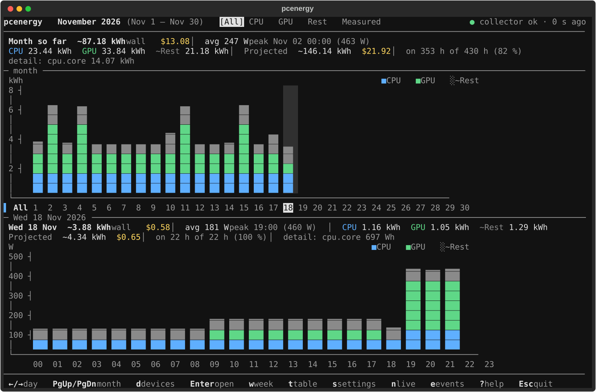

# pcenergy

A light Linux tool that records the PC's energy use — **CPU** (RAPL), **GPU** (NVIDIA NVML, optional AMD
hwmon) and an **estimate for the rest of the system** — keeps the history, and shows it per month, week
and day in an interactive terminal UI with colored graphs. A small read-only HTTP API exposes the same data
for widgets and web pages.



- One sample per minute from hardware energy counters (no polling of `nvidia-smi`, < 0.1 % CPU).
- History in one SQLite file: per-minute rows for 90 days, hourly rows forever.
- Billing months with any start day, weeks starting Monday or Sunday, DST-correct days.
- Measured and estimated figures are always told apart (`~` marks estimates).
- Estimates are computed when you look at the data, so changing a setting updates all history.

## Install

Requires Linux with systemd and Python ≥ 3.12. CPU energy needs a RAPL powercap zone
(`/sys/class/powercap/intel-rapl:0`: Intel, and AMD Zen and later); GPU energy needs an NVIDIA driver.

```bash
git clone https://github.com/rw3iss/pc-energy-usage-utility && cd pc-energy-usage-utility
sudo packaging/install.sh          # collector service (root), starts at boot
uv tool install '.[nvidia]'        # the pcenergy command for your user (or: pipx install '.[nvidia]')
pcenergy doctor                    # checks everything and prints a fix for each problem
pcenergy                           # terminal UI
```

`install.sh` is idempotent (run it again to upgrade) and only touches `/opt/pcenergy`, `/etc/pcenergy`,
`/etc/systemd/system/pcenergy-collector.service` and `/var/lib/pcenergy`.
Remove with `sudo packaging/uninstall.sh` (keeps the history; `--purge` deletes it).

### Why the collector runs as root

The kernel makes the RAPL `energy_uj` files readable by root only (a fix for the PLATYPUS power side
channel). The collector is the only part that runs as root; it has no network access (`PrivateNetwork=yes`,
no capabilities) and only writes its database. Do **not** make `energy_uj` world-readable.
Everything else runs as your user and opens the database read-only.

## Commands

| Command | Does |
|---|---|
| `pcenergy` | Opens the terminal UI |
| `pcenergy month [YYYY-MM \| -1 \| +1]` | Month summary, daily bar graph, day table |
| `pcenergy week [YYYY-MM-DD \| -N]` | Week summary, day bars, table |
| `pcenergy day [YYYY-MM-DD \| -N]` | Day summary, 24-hour graph, hour table |
| `pcenergy now [--watch]` | Live watts per device and the month so far (`--watch`: every 5 s) |
| `pcenergy status` | Collector health, sources, last sample, database size, recent events |
| `pcenergy doctor` | Checks sources, permissions, service, database and settings; prints fixes |
| `pcenergy config [show \| get KEY \| set KEY VALUE \| edit \| path]` | Read or change settings (validated) |
| `pcenergy export [--from D] [--to D] [--bucket hour\|day] [--csv\|--json]` | Export energy per hour or day |
| `pcenergy serve [--port 8787] [--host 127.0.0.1] [--cors ORIGIN]` | Read-only JSON API ([docs/API.md](docs/API.md)) |
| `pcenergy collect [--once] [--interval S] [--source KIND]` | The collector loop (the service runs this). `--once` prints one reading |
| `pcenergy demo-data --days 60 --db FILE` | Fill a database with realistic fake history |

Common flags (before or after the command): `-d/--devices all|cpu|gpu|rest|measured`, `--db PATH`,
`--json`, `--no-color` (also `NO_COLOR`), `--ascii`.

The database path is `--db`, then `PCENERGY_DB`, then `db_path` in `/etc/pcenergy/collector.toml`.

## Terminal UI

The main screen shows, top to bottom: the **month summary**, the **month graph** (one stacked bar per day:
CPU blue, GPU green, iGPU cyan, estimated rest gray), the **day selector** (`All`, then each day), and the
**selected day** (summary and 24-hour graph) — or, on `All`, a table by week and the top 5 days. A dot in the
header shows collector health (green: sample < 3 min old; yellow: older; red: no data).

| Key | Action |
|---|---|
| `←` / `→` (`h` / `l`) | Previous / next day in the selector (wraps through `All`) |
| `↑` / `↓` (`k` / `j`) | Move focus between panels; scroll a table |
| `PgUp` / `PgDn` (`[` / `]`) | Previous / next month period (stops at the first month with data and at the current one) |
| `Home` / `End` | Select `All` / select today (and jump to the current month) |
| `d` or `1`–`5` | Device filter: all, cpu, gpu, rest, measured |
| `Enter` | Open the selected day full screen (on `All`: the week view) |
| `w` | Week view (7 day bars + table; `←`/`→` move by week) |
| `t` | Month panel: graph ↔ table |
| `s` | Settings panel |
| `n` | Live view: watts per device, 10-minute sparklines, refresh every 5 s |
| `e` | Event log (boots, suspends, gaps, warnings) for the shown period |
| `r` | Refresh now (it also refreshes every `refresh_s` seconds) |
| `?` | Help overlay with all keys |
| `Esc` | Close the panel / go back; on the main screen: exit |
| `q`, `Ctrl+C` | Exit at once |

Works in a terminal of 80 × 24 or larger, also over SSH.

## Settings

`pcenergy config set KEY VALUE`, the TUI settings panel (`s`), or edit `~/.config/pcenergy/config.toml`
(`PCENERGY_CONFIG` overrides the path).

| Key | Default | Meaning |
|---|---|---|
| `month_start_day` | `1` | Day a billing period starts (1–31; 31 clamps to the month's last day). `15` → "2026-11" is 15 Nov – 14 Dec |
| `price_per_kwh` | `0.15` | Electricity price per kWh |
| `currency_symbol` | `$` | Shown with costs |
| `fixed_monthly_fee` | `0` | Shown separately, not in graphs |
| `base_watts` | `60` | Estimated draw of the rest of the system (board, RAM, drives, fans, USB) while on |
| `psu_efficiency` | `0.90` | Wall estimate = (CPU + GPU + rest) ÷ efficiency |
| `monitor_watts` | `0` | Monitor draw while the PC is on (0 = not counted; added after the PSU) |
| `include_estimate` | `true` | On: totals show the wall estimate. Off: measured parts only |
| `default_devices` | `all` | Device filter at start |
| `week_start` | `monday` | `monday` or `sunday` |
| `day_graph_unit` | `W` | 24-hour graph in average watts or kWh |
| `graph_style` | `unicode` | `unicode` blocks or `ascii` |
| `color` | `true` | Colors on or off |
| `refresh_s` | `60` | TUI auto refresh (seconds) |
| `theme` | `dark` | `dark` or `light` |

Collector settings (root, `/etc/pcenergy/collector.toml`; restart the service after a change):

| Key | Default | Meaning |
|---|---|---|
| `interval_s` | `60` | Seconds between samples (10–300) |
| `keep_minutes_days` | `90` | Days of per-minute rows to keep (hourly rows are kept forever) |
| `sources` | `["rapl", "nvml"]` | Source plugins; add `"hwmon"` for an AMD GPU / iGPU (power sensor, coarse) |
| `db_path` | `/var/lib/pcenergy/energy.db` | Database file |

## Accuracy

| Part | Source | Kind |
|---|---|---|
| CPU package | RAPL `package-0` energy counter | measured |
| CPU cores | RAPL `core` counter (detail; part of the package, never added) | measured |
| NVIDIA GPU | NVML total energy counter | measured |
| AMD GPU / iGPU | hwmon power sensor, integrated per sample | measured (coarse, optional) |
| Rest of system | `base_watts` × time on | **estimated** |
| Wall total | (CPU + GPU + rest) ÷ `psu_efficiency` (+ monitors) | **estimated** |

Only CPU and GPU are measured. The wall total depends on `base_watts` and `psu_efficiency`; calibrate them
with a plug-in power meter (see [docs/ACCURACY.md](docs/ACCURACY.md), which also has the cross-check results
against `nvidia-smi` and `turbostat`). Suspend time is not counted as "on". Gaps where the collector did
not run are shown as missing (`·`) and logged as events.

## Development

See [docs/DEVELOPMENT.md](docs/DEVELOPMENT.md). Short version:

```bash
uv sync --all-extras
export PCENERGY_DB=/tmp/pce.db
uv run pcenergy demo-data --days 60      # realistic fake history, no hardware or root
uv run pcenergy                          # TUI on the demo data
uv run ruff check && uv run ruff format --check && uv run pytest
```

## License

MIT
